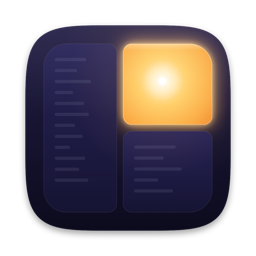
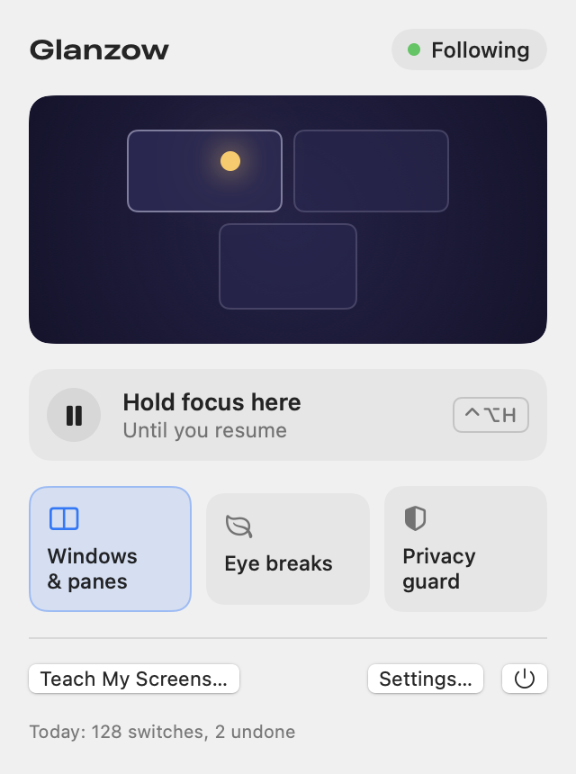
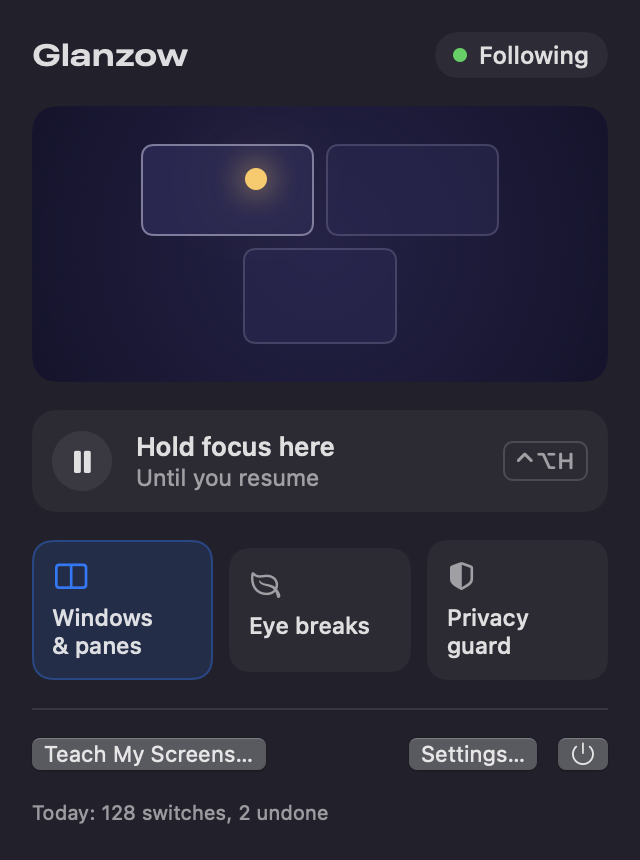
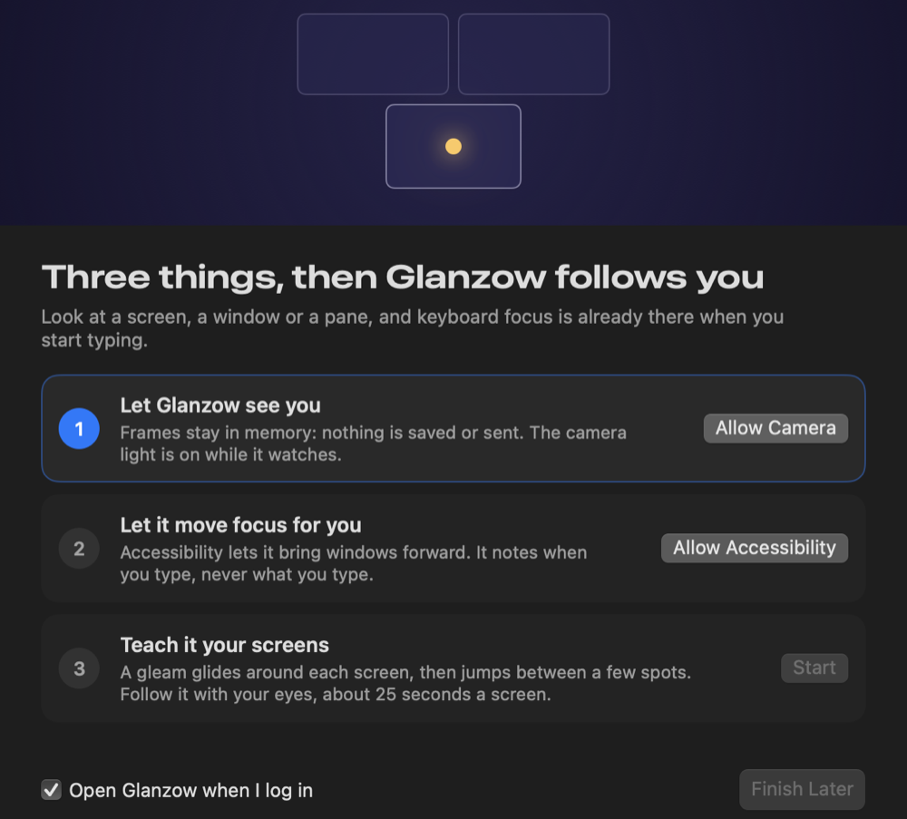
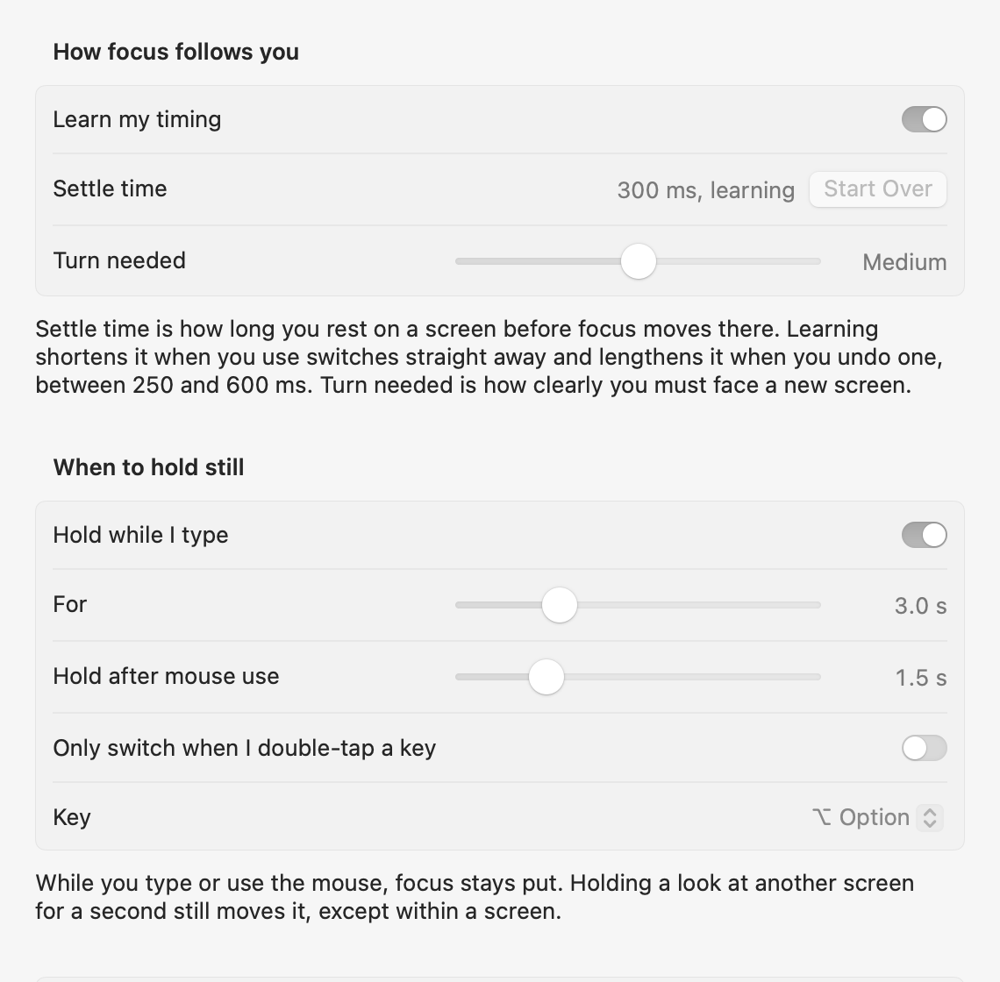
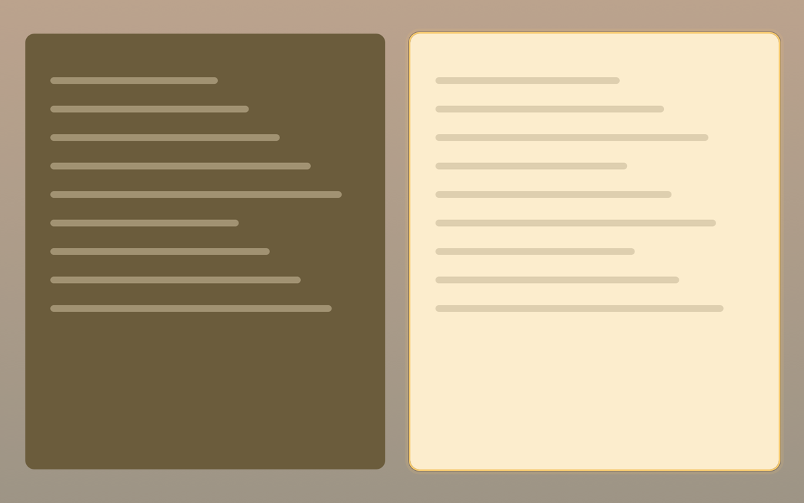
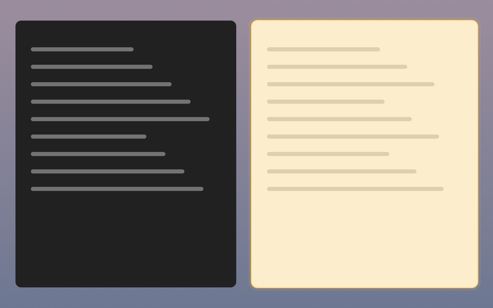

<p align="center">
  
</p>

<h1 align="center">Glanzow</h1>

<p align="center">
  <b>Keyboard focus that follows your eyes.</b><br>
  A Mac menu bar app that moves keyboard focus to the screen, window or split pane you're looking at,
  using your Mac's camera. Everything stays on your Mac.
</p>

<p align="center">
  
  &nbsp;
  
</p>

## What it does

On a Mac with more than one screen, keyboard focus stays on the last window you clicked. You
look at another screen, start typing, and the keystrokes land in the window you left behind.

Glanzow fixes that. It watches where you're looking through the camera and moves keyboard focus
there before you type: to the screen you face, and within that screen to the window or split pane
your eyes rest on. It holds still while you type or use the mouse, pauses while you look away from
your screens, and picks up again the moment you look back.

Camera frames are analysed in memory and thrown away. Nothing is saved or sent, and the app
contains no network code at all.

## Using it

Glanzow lives in the menu bar as its icon in miniature: three panes, with the one you're looking
at lit.

- **Click** it for the panel: a live map of your screens with a gleam where you're looking, a
  switch to hold focus where it is, and toggles for the extras below.
- **Right-click** (or Control-click) it for the menu.

| The menu bar mark | Means |
|---|---|
| One pane lit | Following you |
| No pane lit | Holding: focus stays where it is |
| Faint | Can't see you |
| A small badge | It needs something from you, such as a permission |
| The gleam | Learning your screens |

| Shortcut | What it does |
|---|---|
| ⌃⌥H | Hold focus where it is, or follow you again |
| ⌃⌥Z | Undo the last switch (and teach Glanzow to be a little more patient) |

Both can be changed in Settings › Shortcuts.

| Feature | Default | What it does |
|---|---|---|
| Screens | on | Focus moves to the screen you settle on. The settle time adapts to you, between 250 and 600 ms |
| Windows & panes | on | Within a screen, focus moves to the window or split pane your eyes rest on for about half a second. Panes work in iTerm2, Terminal, Ghostty, kitty, WezTerm, Warp, Zed, Xcode, Sublime Text, VS Code, Cursor, VSCodium and JetBrains IDEs; everywhere else it picks whole windows |
| Switch feedback | flash | A brief warm wash over the screen, window or pane that just took focus, with a gold border on it ("Flash where focus lands" in Settings). Or a glow around the window, or nothing |
| Eye breaks | off | After every 20 minutes of screen time, a nudge to look into the distance; it finishes once you have |
| Privacy guard | off | If someone else watches your screen for 2 seconds, it frosts over until they look away |
| Camera rest | on | After two minutes with nobody in view and no typing or mouse use, the camera turns off until you're back |

## Screenshots

| Setup | Settings |
|:---:|:---:|
|  |  |
| **Focus arrives from another screen** | **Focus moves to another window** |
|  |  |

## Requirements

- macOS 14 Sonoma or later, on Apple silicon (Intel is best-effort)
- Xcode 15 or later, for the Swift toolchain
- A camera that can see your face: the built-in one or any webcam

## Build and run

```sh
git clone https://github.com/anshumansaagar/glanzow.git
cd glanzow
make run
```

`make run` builds `build/Glanzow.app` and opens it. On first launch a setup window walks you
through three steps: let Glanzow use the camera, let it move focus (Accessibility), and teach it
your screens. For that last step a gleam glides around each screen and then jumps between a few
spots; follow it with your eyes, about 25 seconds a screen. The green camera light stays on while
Glanzow is watching, which is expected.

Other commands:

```sh
make app                # build only
make test               # unit tests (no camera needed)
make app CONFIG=debug   # debug build, which adds pose recording to the debug pane
```

The project is a Swift package. `open Package.swift` opens it in Xcode for editing, but launch the
app with `make run`: the camera and Accessibility permissions need a real `.app` bundle, which
`make app` assembles.

### Keeping permissions across rebuilds

macOS ties the camera and Accessibility permissions to the app's code signature. `make app` signs
with a certificate from your keychain when it finds one; an Apple Development certificate, which
Xcode creates for free with any Apple ID, is enough. Without one it signs ad hoc, and because an
ad-hoc signature changes with every build, macOS asks for the permissions again after each
rebuild. To pick a certificate yourself:

```sh
make app SIGN_ID="Apple Development: Your Name (TEAMID)"
```

### Starting over

To run setup again from scratch, or after changing the signing certificate:

```sh
# Forget the camera, Accessibility and Input Monitoring permissions
make reset-permissions
# Optional: erase every setting too, including "setup done"
defaults delete dev.glanzow.Glanzow
```

Input Monitoring is only requested if macOS refuses the keyboard listener with Accessibility alone.

## Where things are stored

| What | Where |
|---|---|
| Settings | `defaults read dev.glanzow.Glanzow` |
| Calibration | `~/Library/Application Support/Glanzow/calibration.json` |
| Switch log (for latency and false-switch review) | `~/Library/Application Support/Glanzow/events.jsonl` |
| Debug recordings | `~/Library/Application Support/Glanzow/Recordings/` |
| Live logs | `log stream --predicate 'subsystem == "dev.glanzow"'` |

The switch log and recordings hold numbers and display IDs only, never images.

## Tuning and debugging

- **Debug settings**: hold Option while the menu is open and choose *Debug Settings…* (debug
  builds always show the tab). It has the smoothing filter values, the off-screen threshold,
  pupil tracking, and the debug overlay.
- **Debug overlay**: live yaw and pitch, the distance to each screen, the current decision, which
  guard is holding a switch back, and a dot where Glanzow thinks you're looking.
- **Recording and replay**: in a debug build, *Start Recording* in the debug pane saves pose
  angles plus keystroke and mouse timestamps. Replay them through the same decision code with
  different settings, without sitting at the desk:

  ```sh
  make replay FILE=~/Library/Application\ Support/Glanzow/Recordings/pose-….json ARGS="--dwell 400 --head-turn 0.7"
  swift run ReplayCLI --help
  ```

- **Diagnostics**: `make diagnostics` writes one text file to the Desktop: settings, calibration
  quality per screen, switch timings (median and 90th percentile), undo counts, a 60-second CPU
  and memory sample, and recent log lines. Numbers only. Glanzow also logs a `perf` line every
  minute: process CPU, frames analysed, time per frame, and memory.

## How it works

```
camera ─▶ face pose (Vision) ─▶ iris centres ─▶ smoothing ─▶ which screen ─▶ where on it ─▶ focus
          yaw, pitch, roll     (gradients)      (One Euro)   (clusters)       (gaze map +      (raise,
                                                                              fixation)        warp)
```

Each step is a published, widely used method rather than an invention:

| Step | Method |
|---|---|
| Head pose | Apple Vision face rectangles, revision 3 |
| Iris centre | Gradient-based eye-centre localisation (Timm & Barth, VISAPP 2011), on a small patch between the eye corners; glints from glasses are ignored by construction |
| Smoothing | One Euro filter (Casiez, Roussel & Vogel, CHI 2012) |
| Which screen | Nearest cluster by Mahalanobis distance, with a hysteresis margin and a dwell before switching |
| Where on the screen | A ridge-regularised linear map from head and eye angles to screen position, fitted during calibration and refitted from your clicks as you work (WebGazer, Papoutsaki et al., IJCAI 2016) |
| Window or pane choice | Dispersion-threshold fixation detection, I-DT (Salvucci & Goldberg, ETRA 2000) |
| Calibration | Smooth-pursuit calibration (Pfeuffer et al., UIST 2013): follow a gleam around each screen; then nine fixed points, the classic grid, looked at eyes-first as in real use |

1. **Calibration** ("Teach my screens") has you follow a gleam that glides once around each
   screen, then look at nine spots it jumps between. Every frame becomes a training pair: where
   your head and eyes pointed, and where the gleam was. A gliding gleam is easy to follow with your
   head; a jumping one is looked at eyes-first, the way you look at things in real use, so it is
   what teaches the up-and-down role of the eyes.
2. **Which screen**: each frame is matched to the nearest screen's cluster. A pose far from every
   screen (phone, desk, someone beside you) pauses switching until you look back. A new screen
   must win for the settle time, counted once your head slows down, so a head sweeping past a
   screen on its way somewhere else doesn't switch to it.
3. **Where on the screen**: the gaze map turns head and eye angles into a point. When your eyes
   rest (a fixation of about half a second) clearly inside another window or pane, focus moves
   there. Panes are focused through Accessibility, or with the app's own pane shortcut when it
   ignores that (iTerm2: ⌥⌘arrow; VS Code: ⌘K ⌘arrow), always checked afterwards.
4. **Never interrupting**: nothing moves while you type (screens allow a deliberate one-second
   look to override; windows and panes never do), use the mouse, or have a menu, dialog, sheet,
   password field, screenshot tool or Mission Control open, or while an excluded app is in front.
5. **Feedback**: a brief warm wash: over the whole screen when focus arrives from another screen,
   over just the window or pane when it moves within one, with a gold border on what took focus.
6. **Learning**: clicks refine the gaze map and the screen clusters; undos and quick returns
   tune the settle time.

The full requirements are in `requirements.pdf`. Code comments cite its requirement IDs
(`FR-FOC-01`, `NFR-04`, …), and wherever the spec was ambiguous a `// SPEC:` comment explains
the choice.

### Project layout

```
Glanzow/
  App/          menu bar and panel, setup, settings, overlays, notifications (the app target)
  Tracking/     CameraCapture, PoseTracker, IrisLocator, OneEuroFilter
  Calibration/  CalibrationOverlay, CalibrationStore, DisplayModel, GazeMap
  Decision/     DisplayClassifier, SwitchController, FixationDetector, ScreenLayout, PrivacyGuard
  System/       DisplayRegistry, InputMonitor, WindowTracker, FocusManager, PaneKeys, AX, Hotkey,
                EventLog, PerfMeter, Palette, Preferences
  Learning/     LearningEngine, SettleLearner, EyeBreakTimer
  Debug/        DebugOverlay, PoseRecorder
GlanzowTests/   XCTest suites: filter, classifier, switch timelines, calibration math, learning, …
ReplayCLI/      replays recorded poses through the same decision code
scripts/        diagnostics, and the app icon drawn in Core Graphics
```

Everything except `App/` builds into the `GlanzowKit` library, so the tests and `ReplayCLI` use
exactly the code the app runs.

## Privacy and security

- No network code and no third-party libraries.
- Frames never leave memory. Stored data is numbers only, in `~/Library/Application Support/Glanzow`
  (folder 0700, files 0600). Settings › Privacy can erase all of it.
- Keystrokes: a listen-only event tap records *when* keys are pressed, never which.
- The app runs with the hardened runtime and exactly one entitlement, the camera. It isn't
  sandboxed, because the Accessibility features it uses to bring other apps' windows forward
  don't work inside the sandbox. `make verify` (run automatically by `make app`) checks the camera
  is the only entitlement, the hardened runtime is on (no debugger attach, no library injection),
  no debug-only code is present, and only Apple system libraries are linked.
- Lock and screensaver state is verified with the system before the camera resumes (the
  notifications themselves can be faked by any process), with a 30-second watchdog.
- The calibration file is validated on load; malformed numbers or shapes are discarded, not trusted.
- Pane shortcuts are delivered only to the target app's process, only while it is frontmost, and
  only when you aren't typing; the opt-in click fallback first checks the point really is inside
  the target pane.

## Known limits

- **Aim within a screen is coarse.** On the developer's three screens, calibration measured aim
  errors of about a tenth of the screen's width side to side, and a quarter or more of its height
  up and down. Side-by-side windows and panes work well; stacked ones often don't.
- **Glances with your eyes alone don't count as looking away.** Pausing goes by where your head
  points: drop just your eyes to your phone and Glanzow still thinks you're on that screen.
- **Head tilt** over 30° is ignored rather than corrected; with your head leaned far over,
  Glanzow can't see you.
- **VS Code, Cursor and VSCodium panes** come from the editor's accessibility tree, which changes
  between versions. If panes aren't picked up, the debug overlay's "region" line shows what
  Glanzow sees.
- **Calls**: Glanzow offers to leave Zoom, Teams, FaceTime, Webex and Skype alone during calls.
  Calls in a browser aren't spotted; add the browser in Settings › Privacy › Leave these apps
  alone if you want the same there.
- **Calibration belongs to one camera and one arrangement of screens.** After moving a screen or
  the camera, run Teach My Screens again. Glanzow asks when a screen it hasn't seen is connected,
  or when your clicks start disagreeing with where it thinks you look.

## License

MIT. See [LICENSE](LICENSE).
